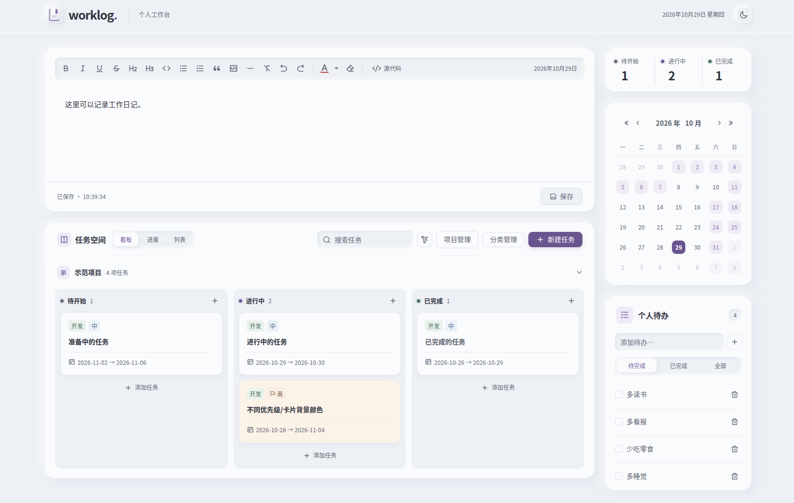
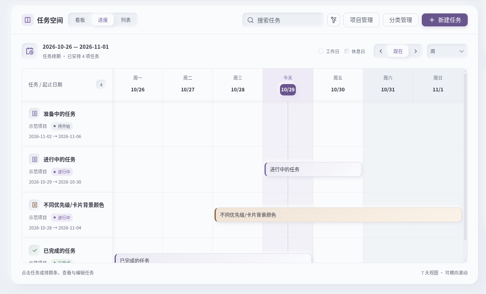

# WorkLog

WorkLog 是面向个人的工作管理系统。  
把项目、任务、临时待办和每天的工作日志放在同一个工作台，方便安排工作、跟踪进度和回顾记录。

你可以在浏览器中使用，也可以让支持 MCP 的 AI 客户端查询和更新工作。  
MCP 是 AI 客户端连接外部工具的协议；在 WorkLog 中，AI 和浏览器使用同一份服务端数据，不需要来回复制记录。

## 能做什么

- **项目与任务**：按项目整理任务，设置分类、优先级和日期；完成的项目可以归档，项目数据可用 ZIP 导入、导出。
- **看板与甘特图**：在列表和看板中跟踪状态，用甘特图查看排期。甘特图按自然日显示，不会自动安排任务日期。
- **待办事项**：记录临时事项，勾选完成。
- **工作日志**：按日期记录富文本日志，支持列表、代码和自动保存。
- **AI 集成**：通过 MCP 查询进度、创建任务或整理日志；也提供 REST API，供其他程序接入。
- **数据与部署**：Vue 前端、Go 后端。默认使用 SQLite，无需另装数据库；也支持 PostgreSQL。可安装桌面版、Linux 服务，或使用 Docker。

这是单用户系统，没有注册、多用户账号或 OAuth 登录。  
当前也没有日志历史、回收站或自动冲突合并，请定期[备份](docs/OPERATIONS.md)。

## 界面预览

### 主界面（看板）



### 进度（甘特图）



## 快速开始

### 在线体验

访问 [在线体验站点](https://worklog.misaka.cn/) 即可体验，无需安装。  
该站点为**纯前端版本**，数据仅存储在当前浏览器中，**可能丢失**，请勿将其作为重要数据的唯一存储。

长期使用建议自行部署或使用桌面版，安装方式见下方。

### 选择安装方式

正式发布包从 [GitHub Releases](https://github.com/MisakaAI/WorkLog/releases) 下载。将文件名中的 `<版本>` 替换为下载页上的实际版本。

| 方式 | 文件或前提 | 操作入口 |
| --- | --- | --- |
| Linux 服务 | `worklog-v<版本>-linux-x86_64.tar.zst` 或 `linux-arm64.tar.zst`；需要 systemd、Bash、tar 和 zstd | [安装与启动](docs/DEPLOYMENT.md#linux-systemd-部署) |
| Windows 桌面版 | `worklog-v<版本>-windows-x86_64.exe` | 下载后运行，界面在默认浏览器中打开；见 [Windows 说明](docs/WINDOWS_DESKTOP.md) |
| macOS 桌面版 | `worklog-v<版本>-macos-arm64.dmg` 或 `macos-x86_64.dmg` | 打开镜像，将 `worklog.app` 拖入 Applications 后启动；见 [macOS 说明](docs/MACOS_DESKTOP.md) |
| Docker Compose | Git、Docker 和 Compose 插件 | [准备凭证并启动](docs/DEPLOYMENT.md#docker-compose)；镜像从源码构建 |
| 从源码运行 | Git、Go 1.27.3、Node.js 24.15+ 和 npm | 见下方命令和[开发文档](docs/DEVELOPMENT.md) |

发布包的目标电脑不需要 Go 或 Node.js。macOS 需要 13+，Apple Silicon 优先选择 arm64。  
桌面包未提供开发者签名，系统可能提示安全警告；请确认来源，不要关闭系统整体安全保护。

Linux 下载包的最短安装流程（以 x86_64 为例）：

```sh
tar --zstd -xf worklog-v<版本>-linux-x86_64.tar.zst
cd worklog-v<版本>-linux-x86_64
bash ./install.sh  # 当前用户的 systemd 服务；安装系统服务则使用 sudo bash ./install.sh
```

Linux 和 Docker 默认访问 **http://127.0.0.1:12450**。  
桌面版使用系统分配的空闲端口，启动后自动打开浏览器；关闭浏览器不会退出服务，请从托盘或菜单栏退出。

### 从源码运行

在安装上述开发依赖后执行，无需发行标签：

```sh
git clone https://github.com/MisakaAI/WorkLog.git
cd WorkLog
(cd Web && npm ci && npm run build)
go build -o bin/worklog ./cmd/worklog
./bin/worklog
```

命令适用于 Bash 等兼容 shell；Windows 可直接使用发布的桌面版。  
保持终端运行，打开 **http://127.0.0.1:12450**。  
首次启动自动创建 SQLite 数据库 `data/worklog.db`，默认业务时区为 `Asia/Shanghai`。

### 第一次使用

1. 创建一个项目，再添加任务；在列表、看板或甘特图中查看进度。  
2. 添加一条待办，按日期写下工作日志。等待保存成功，刷新页面确认记录仍在。  
3. 需要 AI 协助时，按 [MCP 指南](docs/MCP.md)配置客户端。浏览器不需要填写 MCP Token。

默认本机访问无需密码，**同机其他程序也可能访问数据**。  
远程使用前必须配置独立密码、令牌和 HTTPS，不能直接向公网开放 12450 端口。  
详见[身份认证与安全](docs/AUTHENTICATION.md)。

多个页面或 AI 同时修改时，旧版本保存可能冲突。先复制未保存内容，再重新加载最新数据；不要反复覆盖提交。

## 用 AI 管理工作

连接 MCP 后，可以向 AI 提出这类请求：

- “列出这个项目还未完成的任务。”
- “创建一个‘准备周报’任务，截止日期设为本周五。”
- “读取今天的工作日志，帮我整理一下；确认内容后再保存。”

具体是否执行、执行前是否询问，由 AI 客户端决定。建议先使用只读令牌。  
MCP 默认不允许删除、清空日志等操作；写权限仍可修改已有内容，不能代替备份。  
连接、认证和工具说明集中在 [MCP 客户端指南](docs/MCP.md)。

## 文档导航

| 想完成的事 | 文档 |
| --- | --- |
| 安装 Linux 服务、Docker，配置数据库或 HTTPS | [部署与配置](docs/DEPLOYMENT.md) |
| 使用桌面版、查找数据和日志 | [Windows](docs/WINDOWS_DESKTOP.md) · [macOS](docs/MACOS_DESKTOP.md) |
| 配置密码、Token 和访问权限 | [身份认证与安全](docs/AUTHENTICATION.md) |
| 连接 AI 客户端 | [MCP 客户端指南](docs/MCP.md) |
| 备份、恢复和保护数据 | [备份与恢复](docs/OPERATIONS.md) |
| 调用 API、处理版本冲突 | [REST API](docs/REST_API.md) |
| 修改源码、运行测试、构建发布包 | [开发与测试](docs/DEVELOPMENT.md) |
| 调整工作日、节假日和调休 | [工作日历自定义](docs/WORK_CALENDAR.md) |
| 只运行前端或配置浏览器本地模式 | [前端说明](Web/README.md) |
